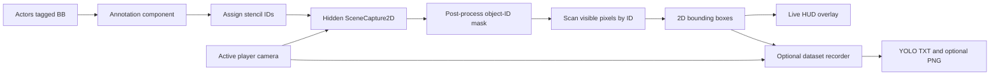

# Unreal Engine Automatic Bounding Boxes

**Real-time, occlusion-aware 2D bounding boxes and optional YOLO dataset recording in Unreal Engine 5.**

This project uses **Actor Tags**, **Custom Depth/Stencil**, a **post-process object-ID mask**, and a **camera-aware HUD** to display bounding boxes around visible objects. You can move a camera through the scene and see annotations update **without saving anything**, or explicitly capture YOLO-format labels and matching images when you want to build a dataset.

## Contents

- [How it works](#how-it-works)
- [Requirements and included files](#requirements-and-included-files)
- [Installation](#installation)
- [1. Enable Custom Depth/Stencil](#1-enable-custom-depthstencil)
- [2. Tag objects](#2-tag-objects)
- [3. Configure the post-process material](#3-configure-the-post-process-material)
- [4. Configure the HUD and GameMode](#4-configure-the-hud-and-gamemode)
- [5. Set up and control the camera](#5-set-up-and-control-the-camera)
- [6. Preview bounding boxes without saving](#6-preview-bounding-boxes-without-saving)
- [7. Optionally record a YOLO dataset](#7-optionally-record-a-yolo-dataset)
- [Configuration reference](#configuration-reference)
- [Troubleshooting](#troubleshooting)
- [Limitations](#limitations)

## How it works



The central class is `UYOLOAnnotationComponent`. On `BeginPlay`, it discovers actors with the `BB` tag and assigns each one a non-zero Custom Stencil instance ID. When its **owning actor is Player 0's active view target**, the component synchronizes a hidden `SceneCaptureComponent2D` with that camera and captures a mask. Each visible tagged pixel carries its object's ID; the CPU scans the mask and creates a tight, screen-space rectangle around the **visible** pixels for each object.

`AYOLOBoundingBoxHUD` draws the current rectangles and labels. `UYOLODatasetRecorder` is a separate, optional step: it serializes the current rectangles into normalized YOLO coordinates, and can capture a clean PNG separately from the debug overlay.

**Two independent workflows:**

| Mode | What happens | Files written? |
| --- | --- | --- |
| **Live preview** | The active camera continuously updates and displays rectangles in the game viewport. | **No** |
| **Record a frame** | A Blueprint activation on each frame writes normalized labels, and optionally a clean image. | **Yes** |

## Requirements and included files

- Unreal Engine **5.6**.
- A **C++ Unreal project** (a Blueprint-only project can be converted by adding a C++ class).

The implementation uses the following source files. Place them in your Unreal project module:

```text
Source/<YourModule>/
├── YOLOAnnotationTypes.h
├── YOLOAnnotationComponent.h
├── YOLOAnnotationComponent.cpp
├── YOLOCameraActor.h
├── YOLOCameraActor.cpp
├── YOLOBoundingBoxHUD.h
├── YOLOBoundingBoxHUD.cpp
├── YOLODatasetRecorder.h
└── YOLODatasetRecorder.cpp

Content/
└── .../M_YOLO_ObjectID.uasset
```

## Installation

1. Create or open a C++ Unreal Engine project and close the editor.
2. Copy the supplied `.h` and `.cpp` files into `Source/<YourModule>/` (or an appropriate subdirectory within that module).
3. Update the exported API macro in the headers. Change `<YOURMODULE>_API` using the macro generated for **your** Unreal module. Do not use the literal angle brackets.
4. Ensure that your module's `.Build.cs` lists the required dependencies. In particular, the Cine Camera class requires `CinematicCamera`; `Core`, `CoreUObject`, `Engine`, and `InputCore` are used by these sources. Your project's existing dependencies may already include some of these.
5. Regenerate project files if required, compile, and reopen the project.
6. Copy/import the `M_YOLO_ObjectID` **material asset** into your project's Content folder; see [section 3](#3-configure-the-post-process-material).


## 1. Enable Custom Depth/Stencil

1. Open **Edit → Project Settings**.
2. Go to **Engine → Rendering → Postprocessing** (the exact category layout may differ slightly by version).
3. Find **Custom Depth-Stencil Pass**.
4. Set it to **Enabled with Stencil**.
5. Restart the editor if the setting or renderer requires it.

**Do not select just “Enabled”**: that creates a depth buffer but does **not** enable the stencil read/write buffer needed for per-object IDs. [Epic's Rendering Settings documentation](https://dev.epicgames.com/documentation/unreal-engine/rendering-settings-in-the-unreal-engine-project-settings) explains the available modes.

If bounding-box edges flicker, try disabling **Custom Depth with TemporalAA Jitter** in the rendering settings.

## 2. Tag objects

For each actor you want to annotate:

1. Select the actor in the Level Editor.
2. In **Details → Actor → Tags**, add `BB`.
3. Add a second Actor Tag with its semantic class, for example `Chicken`, `Pig`, or `Crate`.

**Example:**

```text
Actor: Chicken_03
Actor Tags:
  - BB
  - Chicken
```

- `BB` opts the actor into annotation. The default tracking tag can be changed through `BoundingBoxTag` in the annotation component.
- The **first tag other than `BB`** is the displayed semantic label. Avoid unrelated extra Actor Tags if you require predictable class names.
- Without a class tag, the code falls back to the actor's name.
- The component enables `Render CustomDepth Pass` and assigns `CustomDepth Stencil Value` to the tagged actor's primitive components automatically during refresh. You should not need to manually assign per-object stencil IDs.
- Actors spawned **after** `BeginPlay` are not automatically discovered. Call **`Refresh Tracked Actors`** on the annotation component after adding/removing objects or changing tags.

**Maximum:** the implementation supports up to **255 tracked instance IDs** in one pass (`0` is reserved for background). Instance IDs are assigned at refresh and should **not** be treated as stable persistent object identifiers across sessions or rediscovery.

## 3. Configure the post-process material

The annotation component requires **`M_YOLO_ObjectID`**, a **Post Process** material. This is **not** an outline material added to the player's camera for display. It is used by the hidden annotation capture to encode visible object IDs into a render target. The C++ code creates the hidden capture, dynamic material instance, and render target at runtime.

### Material settings

Open or create `M_YOLO_ObjectID` in the Material Editor:

- **Material Domain:** `Post Process`.
- **Blendable Location:** **After Tonemapping** / **Scene Color After Tonemapping** (wording varies with Unreal version).
- The output must be a **solid, unlit-style ID mask**, not a blend with the original scene color.
- Read each pixel's **CustomStencil** and, to exclude geometry hidden behind other geometry, compare **CustomDepth** against **SceneDepth** with a suitable tolerance. Use a small depth-comparison tolerance appropriate to your scene scale.
- Output **black** for untracked/background/fully occluded pixels.

### Required mask encoding

The implementation's CPU reader expects these channel values for each **visible tagged pixel**:

| Channel | Normalized material output | Approximate 8-bit render target value |
| --- | --- | --- |
| Red | `1.0` | `255` |
| Green | `InstanceID / 255.0` | `InstanceID` |
| Blue | `1.0 - InstanceID / 255.0` | `255 - InstanceID` |

For background or excluded pixels, output `(0, 0, 0)`. A valid ID is an integer from `1` to `255`. The code identifies the mask by checking that red is near `255`, green + blue is near `255`, and green is a currently tracked instance ID.

**Material logic:**

```text
ID = CustomStencil
visible = (ID > 0) AND (CustomDepth <= SceneDepth + DepthTolerance)

if visible:
    Emissive Color = (1.0, ID / 255.0, 1.0 - ID / 255.0)
else:
    Emissive Color = (0.0, 0.0, 0.0)
```

### Assign the material

1. Add a **`YOLOAnnotationComponent`** to the camera/view-target actor or select its existing component.
2. Select the actor and find **YOLO → Visible Pixels** in Details.
3. Set **Annotation Post Process Material** to `M_YOLO_ObjectID`.
4. Initially set **Mask Resolution Scale = `1.0`** and **Minimum Visible Pixels = `1`** for accurate debugging.
5. Compile/save the actor Blueprint if applicable.

**Do not manually attach this material as a visual post-process overlay to the main game camera.** The debug rectangles come from the HUD; the mask material belongs in the annotation component's capture pipeline.

## 4. Configure the HUD and GameMode

The HUD is the **real-time visual overlay**. It reads `GetScreenBoundingBoxes()` from the `UYOLOAnnotationComponent` on the active player view target; it does not calculate boxes on its own.

1. Create a Blueprint subclass of **`GameModeBase`** (for example, `BP_YOLOGameMode`), or edit your current GameMode.
2. In the GameMode's **Class Defaults**, change **HUD Class** to `YOLOBoundingBoxHUD` (or a Blueprint subclass of it).
3. Enable this GameMode under **Project Settings → Maps & Modes → Default GameMode**, **or** select it in **World Settings → GameMode Override** for the demo level.
4. If a level overrides the project GameMode, check the **World Settings** value; the override takes precedence.

`AYOLOBoundingBoxHUD::DrawHUD()` locates Player 0's active view target, finds its annotation component, and draws screen-space rectangles and labels. The HUD renders the current boxes and labels, with configurable display settings.

The overlay uses Unreal's built-in `AHUD` system; no UMG widget needs to be added manually.

## 5. Set up and control the camera

### Option A — Included free-flight YOLO camera (easiest)

The **`AYOLOCameraActor`** derives from `ACineCameraActor` and supports moving around a level while inspecting bounding boxes in real time.

1. Place an instance of `YOLOCameraActor` in your level (or create a Blueprint child named `BP_YOLOCamera`).
2. Select it and assign **`M_YOLO_ObjectID`** on its annotation component, as explained above.
3. Make this camera **Player 0's active view target**. Merely placing it in a level is **not sufficient**.
4. Enter PIE and click/focus the game viewport to send keyboard/mouse input to it.

#### Activate the camera with Blueprint

For a simple demo, in the **Level Blueprint**:

```text
Event BeginPlay
    ├── Get Player Controller (Player Index = 0)
    ├── Reference to your placed BP_YOLOCamera actor
    └── Set View Target with Blend
            Target: Player Controller
            New View Target: BP_YOLOCamera actor
            Blend Time: 0.0
```

You can create an actor reference by selecting the placed camera and adding a reference to it in the Level Blueprint, or by supplying a suitable actor reference from your own camera-manager logic. [Epic: Set View Target with Blend](https://dev.epicgames.com/documentation/unreal-engine/BlueprintAPI/Game/Player/SetViewTargetwithBlend).

**Free-flight camera controls:**

| Input | Action |
| --- | --- |
| `W` / `S` | Move forward / backward |
| `A` / `D` | Strafe left / right |
| `Q` / `E` | Move down / up |
| Hold **right mouse button** + move mouse | Look around |
| Hold **Left Shift** | Move faster |

Adjust the camera's **YOLO → Movement** properties:

| Property | Reference default | Meaning |
| --- | ---: | --- |
| `MovementSpeed` | `500.0` | Normal free-flight speed, in Unreal units per second |
| `FastMovementMultiplier` | `4.0` | Multiplier while Shift is held |
| `MouseSensitivity` | `0.15` | Mouse-look sensitivity |
| `MaxPitchAngle` | `89.0` | Limits looking straight up/down |

These controls use direct key polling in the camera's `Tick` and do not require an Enhanced Input mapping. The game viewport needs keyboard and mouse focus.

### Option B — Your own camera or camera rig

The annotation system is **not restricted to `AYOLOCameraActor`**. To use a different camera actor, add `UYOLOAnnotationComponent` to the actor that is Player 0's **active view target** and assign `M_YOLO_ObjectID`.

The essential requirement in the current implementation is:

```cpp
PlayerController->GetViewTarget() == AnnotationComponent->GetOwner()
```

This is especially important with Pawns and Blueprints containing Camera Components: **the view target is typically the owning Pawn/Actor, not the `UCameraComponent` itself**. Put the annotation component on the active view-target Actor. The component calls the owner's `CalcCamera()` to get its actual view.

### Option C — Cameras controlled by Blueprint, player input, or Sequencer

- **Blueprint-controlled movement:** move/rotate the active camera actor; annotations update while its view target remains active.
- **Player-controlled camera:** attach the annotation component to the active camera-owning Pawn/Actor; do not assume that the custom free-flight keys apply to your own controller.
- **Switching cameras:** change Player 0's active view target with `Set View Target with Blend`. Put the annotation component and material on **each** candidate view-target actor if you want bounding boxes while using it.
- **Sequencer/Cine Cameras:** keep the camera projection, aspect ratio, and constrained image rectangle consistent with the annotation capture, particularly when letterboxing or pillarboxing is enabled.
- **Other view modes:** the existing implementation only computes annotation boxes while the component owner is the active **Player 0 view target**. Offscreen/inactive cameras will not continuously compute boxes by default.

**A camera being visible in the Editor is not the same as being the active Player 0 view target in PIE.**

## 6. Preview bounding boxes without saving

After completing steps 1–5:

1. Place at least one Actor with the tags `BB` and a semantic class.
2. Start PIE.
3. Activate the configured camera and look toward the tagged actor.
4. You should see a rectangle and a class label that update as the camera or object moves.
5. Move behind geometry or move the tagged actor out of frame. Its box should disappear when the mask has no visible pixels for that instance.

**This preview writes no images or YOLO text files.** It works continuously as long as the annotated camera is the active view target. To generate data on disk, invoke the recorder explicitly in the next step.

If you spawn new tagged objects or change tags during play, call `Refresh Tracked Actors` to re-scan the world and assign stencil IDs.

## 7. Optionally record a YOLO dataset

`UYOLODatasetRecorder` is a Blueprint Function Library. It exposes the node **`Record YOLO Bounding Boxes`**, which saves the boxes already calculated by `UYOLOAnnotationComponent`. Set this for each frame to record a sequence of labels such for a video.

### Blueprint example: capture on demand

In a Blueprint that receives your desired capture input (for example a Player Controller, Pawn, or Level Blueprint), call:

```text
Your capture event (e.g. input action / keyboard key)
    └── Record YOLO Bounding Boxes
          Annotation Component: [leave unset to use active view target]
          Frame Name: frame_000001
          Separate Instances by ID: false
          Capture Image: true
          Output Folder: YOLODataset
          Return Value: true on success
```

For repeated recordings, generate **unique** frame names (such as an incrementing zero-padded counter, or leave the string empty to use a timestamp). Reusing the same name can overwrite earlier `labels/*.txt` and `images/*.png` files.

**Inputs:**

| Input | What it does |
| --- | --- |
| `AnnotationComponent` | Optional explicit provider of boxes; if omitted, the recorder looks on Player 0's active view target. |
| `FrameName` | Filename stem for the image/label pair; empty creates a timestamp-based stem. |
| `bSeparateInstancesByID` | `false` = common semantic classes; `true` = classes such as `Pig_ID_1`. |
| `bCaptureImage` | `true` = write a clean PNG paired with the label file; `false` = label file only. |
| `OutputFolder` | Relative to the project's `Saved/` directory, or an absolute folder path. Default: `YOLODataset`. |

### Output files

By default, recorded datasets are stored in `<Project>/Saved/YOLODataset/`:

```text
YOLODataset/
├── classes.txt
├── label_mode.txt
├── images/
│   └── frame_000001.png
└── labels/
    └── frame_000001.txt
```

The output directory can be changed using `OutputFolder`. Image generation is optional and can be disabled when only annotations are required.

## Configuration reference

| Setting | Location | Purpose |
| --- | --- | --- |
| `Custom Depth-Stencil Pass = Enabled with Stencil` | Project Settings → Rendering | Enables per-object stencil IDs. |
| `BoundingBoxTag` (`BB`) | `YOLOAnnotationComponent` | Actor tag used for opt-in tracking. |
| `AnnotationPostProcessMaterial` | `YOLOAnnotationComponent` | Required object-ID mask material. |
| `MaskResolutionScale` (`1.0`) | `YOLOAnnotationComponent` | Mask resolution relative to viewport/camera rectangle; lowering it can improve speed but reduce edge precision. |
| `MinimumVisiblePixels` (`1`) | `YOLOAnnotationComponent` | Ignore detections below the threshold. |
| `HUD Class` | GameMode / Maps & Modes / World Settings | Enables live screen overlay. |
| `View Target` | Player Controller 0 | Selects which camera actor supplies live annotations. |
| `MovementSpeed`, `MouseSensitivity`, etc. | `YOLOCameraActor` | Free-flight camera tuning only. |

## Troubleshooting

### No boxes are visible

1. Verify that **Custom Depth-Stencil Pass** is **Enabled with Stencil**, not just Enabled.
2. Confirm the Actor has the `BB` tag and is in frame.
3. Confirm the active view target has a **`YOLOAnnotationComponent`** and `M_YOLO_ObjectID` assigned.
4. Confirm the active GameMode uses **`YOLOBoundingBoxHUD`** as HUD Class; check **World Settings → GameMode Override**.
5. If you spawned the actor after play began, call **`Refresh Tracked Actors`**.
6. Check the **Output Log** for messages such as a missing `AnnotationPostProcessMaterial` or the number of tracked actors.
7. Verify that Player Controller **0** really sees the expected actor as `GetViewTarget()`.

### The game view works, but the annotation capture is black

Check the post-process material's domain/blendable location and its assignment on the annotation component. Keep the capture camera's post-process settings when calling `SetCameraView()`, and add the mask material as a blendable afterward. Clearing `PostProcessSettings` at this stage can produce a black capture in Unreal Engine 5.6.

### Boxes are shifted, stretched, or incorrect near the edges

Check **Cine Camera filmback, constrained aspect ratios, PIE viewport offsets, and projection matrices**. Ensure the annotation capture and the RGB camera use the same projection and image rectangle. Compare box alignment at the center and edges of the view.

### Hidden objects still receive boxes

The post-process material may be outputting Custom Stencil regardless of scene occlusion. Verify that it uses the **CustomDepth vs SceneDepth visibility test** and outputs black for fully occluded pixels. Transparent objects and unusual material/rendering paths may need special handling.

### Lots of false positives or missing small objects

Inspect the post-process mask's **exact RGB signature**. The CPU reader expects `(255, ID, 255 - ID)` for visible instances, with a small quantization tolerance; an ordinary scene-color render target is not a valid replacement. For tiny objects, try `MaskResolutionScale = 1.0` and `MinimumVisiblePixels = 1`.

### Free-flight controls do nothing

Ensure the camera is Player 0's **active view target**, PIE has keyboard/mouse focus, and the controller is not consuming or restricting mouse input unexpectedly. Right-mouse look requires **holding** the right mouse button in the included camera implementation.

### Recording fails or produces no image

Check the recorder's Boolean return value and the **Output Log**. Verify that the active view target has an annotation component, `Saved/` is writable, `bCaptureImage` is enabled, the frame name is safe, and the capture/image pipeline works independently of the HUD.

### Image and label files do not match

Use one stable camera state per recording and validate a test image with drawn boxes. The recorder creates a separate clean capture and normalizes labels against the constrained camera image rectangle. Resize/letterbox changes or mismatched post-process settings can create alignment errors; do not rely on the overlay appearance alone when validating datasets.

## Limitations

- **Local Player 0 only** in the present implementation. Multi-player, multi-view, and inactive-camera batch annotation require code changes.
- **255 non-zero stencil instance IDs** available per pass.
- **Re-scan required** for actors spawned, removed, or retagged after initial discovery.
- **Visible-pixel 2D rectangles**, not exported polygon segmentation masks or 3D bounding boxes.
- **CPU mask readback each active frame** (`ReadPixels`) can be expensive; reduce mask resolution for preview and profile before scaling to large datasets.
- **Instance IDs are not persistent tracking IDs** across scene loads or refreshes.
- Visibility and silhouette accuracy depend on the custom-depth/stencil rendering path, material behavior, and handling of translucent/masked objects.

## For Developers and Researchers

This tool is a "thank you" of mine to the community, I searched for a while for tools that annotate bounding boxes for Unreal but the only open source free one I found was quite outdated for recent versions.

The code found in this repository was initially done with the usage of AI and my personnal guidance and insight. This tool was tested in an internal research project of mine with great results.

If you plan on using and developing with this tool, consider helping this repository by presenting your changes.

